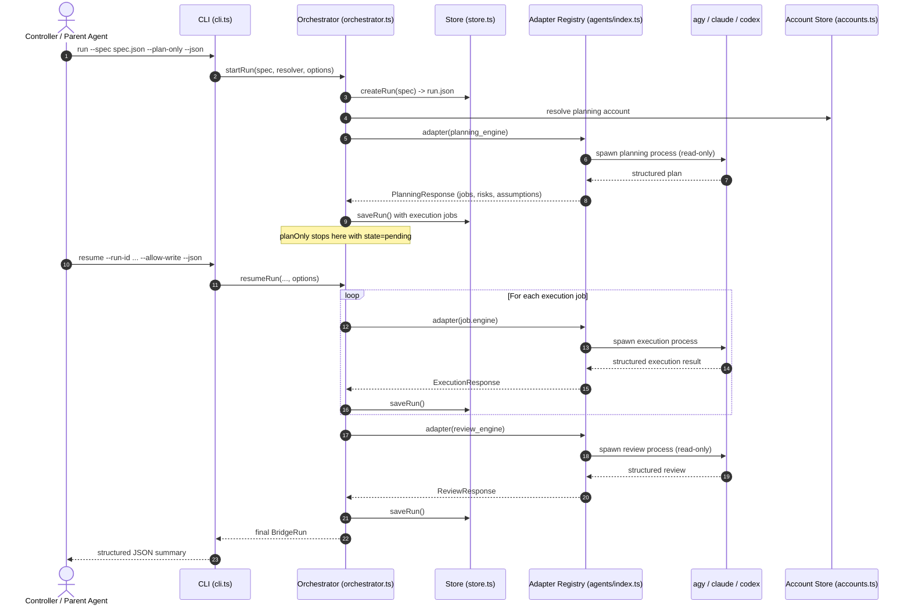

# Omega Agent Bridge Architecture

Omega Agent Bridge is a local orchestration system that lets a high-level controller (a parent AI agent, dashboard, or script) keep strategic control while delegating bounded implementation work to one or more local CLI engines:

- `agy` — Antigravity CLI
- `claude` — Claude Code CLI
- `codex` — Codex CLI

This document explains the components, run lifecycle, engine routing, account isolation, state management, and the safety boundaries.

---

## 1. System Overview

The bridge provides a stable, machine-readable, and resumable orchestration layer above raw agent execution. It breaks goals into plans, routes jobs to engines and isolated accounts, tracks execution, handles follow-ups, and performs an independent review.



Key elements:

- **CLI:** argument parsing, spec loading, overrides, JSON output, exit codes.
- **Orchestrator:** run state machine, engine routing, job scheduling, approval gating, review cycles, cancellation, resume.
- **Adapter registry:** creates the adapter for each engine.
- **Adapters:** build CLI arguments, spawn processes, parse structured output, rotate accounts, verify runtime.
- **Account store:** discovers profiles, isolates authentication, tracks non-secret health, migrates legacy layouts.
- **Store:** atomic run persistence, artifacts, and logs.

---

## 2. CLI Entrypoint (`src/cli.ts`)

The command-line interface is built with `commander`. It exposes the run lifecycle plus onboarding and account management.

### Run commands

- **`setup`**: guided first-run onboarding. Detects engines, creates the state layout, writes config, optionally starts an interactive login, optionally migrates legacy flat `agy` accounts, and prints next steps. Supports `--dry-run`, `--no-login`, `--engine`, `--migrate-legacy`, and `--json`.
- **`doctor`**: checks the state directory, config, engine binaries, and authenticated accounts. Reports `ok`, `warn`, and `fail` checks.
- **`run`**: creates a run from `--spec <path>`.
  - Loads and validates the spec with `parseRunSpec`.
  - Applies `--engine`, `--planning-engine`, `--review-engine`, `--allowed-engines`, and `--account` overrides.
  - Builds an adapter resolver from config, environment, and binary overrides.
  - Calls `startRun(spec, resolver, runOptions)`.
  - `--plan-only` stops after planning. `--allow-write` records explicit write approval for this run.
- **`resume`**: continues a pending or interrupted run. A write-capable run requires `--allow-write` on the resume invocation that should execute it.
- **`status`**: compact summary of one run.
- **`show-run`**: full `BridgeRun` document.
- **`list-runs`**: summaries for a state directory.
- **`cancel`**: writes `cancelRequested: true` so the orchestrator stops before the next job.

### Account commands

`account list`, `account status`, `account login`, `account migrate`, `account prune`, and `account clean` operate on engine-scoped profiles. Emails are masked unless `--show-emails` is used. Destructive operations require explicit flags.

---

## 3. Orchestrator Flow (`src/orchestrator.ts`)

Both `startRun` and `resumeRun` route through `continueRunInternal`, which processes planning, execution, and review.

### 3.1 Engine resolution

A spec carries:

- `engine`: default execution engine
- `planning_engine`: engine for the plan
- `review_engine`: review engine or `auto`
- `allowed_engines`: engines a plan may assign
- `fallback_engines`: engines allowed only on an exhausted account pool

The planning response may set `engine` per job. The orchestrator validates every job engine against `allowed_engines` before creating jobs. `review_engine: "auto"` chooses the first allowed engine different from the execution engine.

`startRun` and `resumeRun` accept either a single `AgentAdapter` or an `AgentResolver`. The resolver form is used by the CLI to instantiate the adapter for each engine. The single-adapter form preserves the public API and the existing tests.

### 3.2 Planning phase

1. Creates a `planning` job on `planning_engine`.
2. Builds a planning prompt with the goal, constraints, success criteria, default engine, and allowed engines.
3. Invokes the adapter read-only (`canWrite: false`).
4. Parses `planningResponseSchema`:
   - `summary`
   - `jobs[]` with objective, success criteria, write intent, priority, optional engine, and optional account
   - `risks` and `assumptions`
5. Rejects jobs assigned outside `allowed_engines` or to an account that belongs to another engine.
6. Caps jobs at `max_subjobs` and registers them as `execution` jobs.
7. If `planOnly` is set, sets the run state to `pending` and returns without dispatching execution.

### 3.3 Write approval

Write approval is a run-level record:

```ts
interface WriteApproval {
  at: string;
  source: "user";
}
```

Rules:

- The CLI always passes `requireWriteApproval: true`.
- A write-capable job cannot start until the run has a `writeApproval` record.
- `--allow-write` on `run` or `resume` creates that record.
- If approval is missing when a writer is next, the run stays `pending` and prints the exact resume command.
- Direct library callers that pass no options keep the historical behavior; this is the compatibility path for existing API users and tests.

### 3.4 Execution phase

1. Pending execution jobs are sorted by priority and insertion order.
2. Independent read-only jobs run concurrently up to `MAX_CONCURRENT_READ_JOBS = 10`.
3. Write-capable jobs and follow-up jobs are exclusive: all active read jobs finish first, then the writer runs alone.
4. The execution prompt includes the run goal, constraints, job objective, success criteria, runtime engine/account information, and prior completed work.
5. Results follow `executionResponseSchema`:
   - `done`: job completed.
   - `needs_followup`: job completed, and a follow-up job is appended when attempts remain.
   - `blocked`: job blocked, run marked `failed`, dispatch stops.
6. Follow-up jobs inherit the source job's engine and account.
7. Cancellation is checked between jobs and reconciled against the on-disk run document.
8. Persistence uses atomic writes and a serialized per-run save queue.

### 3.5 Review phase

1. After execution, the orchestrator creates a `review` job on `review_engine`.
2. The review prompt includes the goal, criteria, completed work, review pass number, and a read-only instruction.
3. The adapter runs with `canWrite: false`.
4. `reviewResponseSchema` yields:
   - `pass`: run completed.
   - `blocked`: run failed.
   - `needs_followup`: a gap-closing execution job is appended, then the next review pass runs, up to `review_pass_limit`.
5. Gap-closing jobs run on the default execution engine and require the same write approval as other writers.

### 3.6 Failure and fallback

- An engine failure is summarized from the last useful output lines.
- Account-pool exhaustion is detected by `all_accounts_exhausted`.
- Cross-engine fallback is considered only when `fallback_engines` is non-empty and the failure is pool exhaustion.
- A used fallback is recorded in `runtime.fallbackFrom` and `runtime.fallbackReason`.
- Other errors fail the job; the orchestrator does not silently switch engines, models, or effort.

---

## 4. Adapter Layer (`src/agents/`)

All adapters implement the `AgentAdapter` contract and receive an `AgentInvocation` with the prompt, workspace, timeout, log path, run label, write intent, model, effort, account, and optional response schema. They return an `AgentResult` with raw and combined output, exit code, duration, and an `AgentRuntime` record.

### 4.1 `agy` (`src/agents/agy.ts`)

- Spawns `agy` with print, timeout, log-file, and workspace arguments.
- Uses `--dangerously-skip-permissions` when auto-approval is required; read-only intent is carried by the prompt and permission posture.
- Selects and verifies the strongest advertised model and highest adjustable effort.
- Preserves the legacy Opus-to-Gemini quota fallback for backward compatibility, recorded through `runtime.fallbackFrom` and `runtime.fallbackReason`.
- Supports engine-scoped accounts under `accounts/agy/<id>` and legacy flat accounts under `accounts/<id>`.

### 4.2 `claude` (`src/agents/claude.ts`)

- Uses `CLAUDE_CONFIG_DIR` for account isolation.
- Read-only intent maps to `--permission-mode plan`.
- Write intent maps to `--permission-mode bypassPermissions`.
- Consumes JSON output, extracts the structured result, and verifies the reported model.
- Rotates accounts on quota or rate-limit failures.

### 4.3 `codex` (`src/agents/codex.ts`)

- Uses `CODEX_HOME` for account isolation.
- Read-only intent maps to `--sandbox read-only`.
- Write intent maps to `--sandbox workspace-write`.
- Uses `codex exec --json` and `--output-last-message` to capture the final structured message.
- Verifies the reported model and rotates accounts on quota or rate-limit failures.

### 4.4 Adapter rules

- Never invoke the bridge or another adapter recursively.
- Validate explicit model requests against the engine's advertised catalog.
- Fail rather than silently downgrade an unavailable model, effort, or engine.
- Record the account actually used.
- Keep prompts, logs, and runtime records free of secrets.

---

## 5. Account Store (`src/accounts.ts`)

Profiles are stored per engine:

```text
<state-dir>/accounts/
├── agy/account-01/ ...
├── claude/account-01/ ...
└── codex/account-01/ ...
```

Account IDs are normalized to `account-NN` for the default pool. A bare ID such as `account-2` is interpreted for the default `agy` engine; `engine:id` selects another engine; an absolute path selects a custom `agy` profile.

The store provides:

- profile discovery and authentication detection
- account-reference parsing and formatting
- ignored-profile handling when the configured cap is exceeded (extras are not deleted)
- cooldown health checks
- legacy flat-`agy` migration that copies profiles and leaves the originals untouched

Rotation uses authenticated, non-ignored profiles. A pinned account limits the run to that profile. Cooldown and health metadata contain no credentials.

---

## 6. Run Storage (`src/store.ts`)

State is fully structured and persisted locally so runs can be audited, resumed, or inspected.

### Directory structure

```text
.omega-agent-bridge/
├── config.json
├── accounts/<engine>/<account-id>/
└── runs/
    └── <run-id>/
        ├── run.json
        ├── artifacts/
        │   ├── planning-001.prompt.txt
        │   ├── planning-001.response.txt
        │   ├── execution-002.prompt.txt
        │   ├── execution-002.response.txt
        │   └── review-003.response.txt
        └── logs/
            ├── planning-001.log
            ├── execution-002.log
            └── review-003.log
```

### Data schema

- **`BridgeRun`**: run metadata, spec, state, summaries, plan context, write approval, final report, and jobs.
- **`BridgeJob`**: phase (`planning`, `execution`, `review`), status, timestamps, attempts, engine, account, prompt/response/log paths, structured result fields, and runtime verification data.
- **`AgentRuntime`**: requested and selected model/effort, effective values, verification flag, account, and optional fallback metadata.

Run state values include `running`, `pending`, `completed`, `failed`, and `cancelled`. `pending` means the run is waiting for write approval or another explicit resume.

---

## 7. Security Boundaries and Concurrency

### Honest limitations

- **Directory copies are not a security boundary.** Engines started with auto-approved permissions retain host-level filesystem access. A copied workspace does not sandbox them.
- **TOCTOU risk in auto-integration.** Snapshot-and-copy integration has unavoidable time-of-check/time-of-use races on ordinary filesystems.
- **No OS-level sandbox on standard Windows setups.** Reliable per-writer restriction is not available in the general developer environment.
- **Parallel writing is disabled.** All write-capable jobs run strictly sequentially with exclusive workspace access. Automatic integration is disabled.

### Preserved concurrency

- **Read parallelism:** independent read-only jobs run concurrently up to ten workers.
- **Independent review:** review runs read-only after execution and can use a different engine.
- **Exclusive writers:** only one writer touches the workspace at a time.

### Operational rules

- Run only against trusted workspaces.
- Keep secrets out of specs, prompts, logs, reports, and commits.
- Prefer narrow workspaces over broad root access.
- Require explicit approval for every write-capable run.
- Verify the final diff and checks yourself; a passing review is evidence, not proof.

---

## 8. Controller Integration

A controller invokes the bridge as a subprocess and consumes JSON:

```bash
npx omega-agent-bridge run --spec ./spec.json --plan-only --json
npx omega-agent-bridge resume --run-id <run-id> --allow-write --json
```

Design principles:

1. **JSON output:** `--json` prints a compact, valid summary. `show-run --json` returns the complete run document when job-level detail is needed.
2. **Exit codes:** `run` and `resume` set a non-zero exit code when the final state is `failed` or `cancelled`.
3. **Resumability:** interrupted runs can be continued with `resume --run-id`. The stored job sequence is preserved.
4. **Explicit approval:** controllers must pass `--allow-write` for the specific run they intend to execute.
5. **Independent audit:** the controller inspects the diff and runs the checks before reporting completion.

The bundled skill (`skills/omega-agent-bridge/SKILL.md`) encodes this workflow for Codex, Claude, and Antigravity controllers. `npm run build` generates the controller-specific copies.
